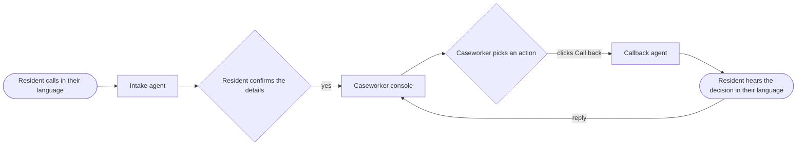

<h1 align="center">City<em>Line</em></h1>

<p align="center"><strong>311 that speaks your language, and a caseworker console that talks back.</strong></p>

CityLine is a voice line for city service complaints, built first for New York tenants with issues. A resident calls one number and speaks in their own language. A voice agent takes the complaint, checks it against the city's laws and policies in real time, and files it only after the resident says yes. The case lands on a caseworker console already translated into English and paired with the building's history. When the caseworker decides what happens next, CityLine calls the resident back and delivers that decision in their language.

The people who struggle most with 311 are often elderly or not comfortable in English, and every step of a heat complaint today happens in English, through phone menus, during working hours. CityLine removes the language barrier on both ends of the conversation. The city is the customer, and the resident never has to download anything.

## How it works



**On the resident's side,** the intake agent says it is an AI assistant, asks one question at a time, and collects the name, address, unit, how long the heat has been out and the temperature inside. It compares that reading with the outdoor temperature at that hour and tells the resident whether it may be a violation. It reads everything back and submits nothing until the resident agrees. A confirmation text then arrives in the resident's language, and the resident can reply by text or by voice note.

**On the city's side,** the caseworker sees a live queue and every call while it is happening, with each line translated into English as it is spoken. A case shows the original transcript next to the English, the heat-law check, and the building's open violations and complaint history from NYC Open Data. The caseworker chooses an action, edits the message in English, and clicks once to have it delivered as a phone call in the resident's language.

There is a human checkpoint on each side. Nothing reaches the city without the resident's yes, and nothing reaches the resident without the caseworker's click. Heat complaints get the full violation check, and the same line also takes hot water, potholes, missed pickups, streetlights, water, noise and animal reports. The agents have been tested in Hindi, Spanish and English.

## What's in the repository

| Folder | What it holds |
|---|---|
| `agent/` | `provision.py` defines the intake and callback voice agents, their prompts and their tools, and creates or updates them in ElevenLabs |
| `backend/` | The FastAPI service. `app/hc.py` is the CityLine API, with the heat rule, translation, texting and the call log in the modules around it |
| `console/` | The caseworker console, a Next.js app that reads cases live from Supabase |
| `supabase/` | The database schema, applied once to a Supabase project |
| `dashboard/` | The original 311 case desk this project grew out of, served by `app/main.py` |
| `docs/` | The decision log and the roadmap |

The API contract is in [CONTRACT.md](CONTRACT.md), the agent prompts in [AGENTS.md](AGENTS.md), the console spec in [DASHBOARD.md](DASHBOARD.md), and the demo script in [PITCH.md](PITCH.md).

## Run it locally

The backend and the console run on your machine. The voice agents run in ElevenLabs and reach your backend through a tunnel, and the data lives in a Supabase project you create. Texting through Twilio is optional.

### What you need

- [uv](https://docs.astral.sh/uv/), which installs Python 3.13 for you, and Node 20.9 or newer.
- `cloudflared` for the tunnel, installed with `brew install cloudflared`.
- Accounts with Supabase and ElevenLabs, plus Twilio if you want real phone calls and texts.
- An LLM API key for translation and summaries. The supported providers and their variable names are listed in `backend/app/llm.py`.

### 1. Create the database

Make a Supabase project and paste [supabase/schema.sql](supabase/schema.sql) into its SQL editor once. Keep three values from the project settings, which are the session pooler connection string, the project URL and the publishable key.

### 2. Start the backend

```sh
cd backend
cp .env.example .env
uv sync
uv run uvicorn app.hc:app --reload --port 8000
```

Fill in `backend/.env` before you start it.

| Variable | Value |
|---|---|
| `HC_DATABASE_URL` | The Supabase session pooler connection string |
| `HC_TOOL_SECRET` | Any random string, made with `python3 -c "import secrets; print(secrets.token_urlsafe(24))"` |
| `ELEVENLABS_API_KEY` | An ElevenLabs key with Agents read and write access |
| `ELEVENLABS_INTAKE_AGENT_ID` and `ELEVENLABS_CALLBACK_AGENT_ID` | Printed by step 4 |
| `ELEVENLABS_WEBHOOK_SECRET` | Shown once when you create the post-call webhook in step 4 |
| LLM key | One key for translation and summaries, named as in `backend/app/llm.py` |

The example file also lists settings for the original case desk, such as `VOICE_TOOL_SECRET`. CityLine reads `HC_TOOL_SECRET` instead.

### 3. Open a tunnel

```sh
cloudflared tunnel --url http://localhost:8000
```

This prints a public `https://…trycloudflare.com` address. ElevenLabs and Twilio use it to reach your backend.

### 4. Create the voice agents

```sh
cd agent
cp .env.example .env    # set PUBLIC_BACKEND_URL to the tunnel address and HC_TOOL_SECRET to the backend's value
uv sync
uv run python provision.py
```

The script prints an id for each agent. Put both ids in `agent/.env` and `backend/.env`, then restart the backend. Run the script again whenever you edit a prompt or the tunnel address changes, and it will update the same agents.

Next, create a post-call webhook in your ElevenLabs workspace settings that points at `https://<tunnel>/api/webhooks/elevenlabs_post_call`. Copy its secret into `ELEVENLABS_WEBHOOK_SECRET`, and replace `POST_CALL_WEBHOOK_ID` in `agent/provision.py` with your webhook's id, because the file currently holds ours.

### 5. Start the console

```sh
cd console
cp .env.example .env.local    # your Supabase URL and publishable key, and NEXT_PUBLIC_API_URL=http://localhost:8000
npm install
npm run dev
```

Open http://localhost:3000 to see the queue.

### 6. Add demo cases

```sh
cd backend
HC_DATABASE_URL="<your session pooler connection string>" uv run python -m scripts.hc_seed
```

This adds four older cases in different languages so the queue looks real. The script does not read `backend/.env`, so pass the connection string as shown. It is safe to run more than once.

### 7. Make a call

You can talk to the intake agent from its page in the ElevenLabs dashboard, and the case appears on the console when you confirm it. To use a real phone, import a Twilio number into ElevenLabs, assign it to the intake agent, and set `ELEVENLABS_PHONE_NUMBER_ID` in `backend/.env` so call-backs come from that number.

For texts, set the `TWILIO_*` values in `backend/.env`. US text messaging requires a carrier registration that takes days, so the demo sends over the Twilio WhatsApp sandbox with `TWILIO_CHANNEL=whatsapp`, and each phone joins the sandbox once. Point the sandbox's incoming message webhook at `https://<tunnel>/api/webhooks/twilio_sms` so replies and voice notes reach the case.

### Run the tests

```sh
cd backend && uv run pytest
cd agent && uv run pytest
cd console && npm run lint && npm run build
```

## Current status

CityLine is a working demo, not a city system. It is not connected to the real 311 or HPD, and its case numbers are its own. Line-by-line live transcripts on the console depend on ElevenLabs realtime monitoring, which is an Enterprise feature. Without it, calls still appear live and the full transcript arrives when the call ends. More complaint types, real agency integration and landlord outreach are next on the [roadmap](docs/ROADMAP.md).
